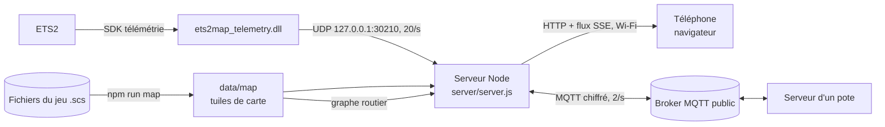

# ETS2-Map

La carte d'Euro Truck Simulator 2 en direct sur ton téléphone : position du camion, **itinéraire en rouge sur la route**, **les potes du convoi en direct**, routes, échangeurs, stations, logos des entreprises, destination de la livraison, vitesse, limitation, régulateur, distance et heure d'arrivée, délai, carburant et pause, avec l'équivalent en temps réel sous chaque temps du jeu (le temps du jeu passe 19 fois plus vite sur la route).



| Partie | Dossier | Rôle |
|---|---|---|
| Plugin du jeu | `plugin/` | DLL C++ (SDK officiel SCS 1.14). Lit position, cap, vitesse, limitation, GPS, mission, carburant, heure du jeu. Envoie un petit JSON en UDP local 20 fois par seconde, 1 fois par seconde en pause. Ne bloque jamais le jeu. |
| Serveur | `server/server.js` | Reçoit l'UDP, sert l'appli et la carte, pousse la télémétrie aux téléphones (Server-Sent Events). Aucune dépendance obligatoire. |
| Appli téléphone | `web/` | Carte vectorielle dessinée en Canvas, orientée dans le sens de la marche, zoom auto selon la vitesse, gestes (glisser, pincer, double tap), thème nuit/jour, ajout à l'écran d'accueil. |
| Itinéraire | `server/route.js` | Calcule l'itinéraire le plus rapide (A*, 2 à 25 ms pour toute l'Europe) sur le graphe routier du jeu : voies, sens uniques, tourne-à-gauche des échangeurs, ferries. Recalcule si tu sors de l'itinéraire plus de 2,5 s. |
| Convoi | `server/convoy.js`, `server/convoy-hub.js` | Partage ta position, ta mission et ton itinéraire avec les potes du même code de convoi, via un broker MQTT public. Tout est chiffré (AES-256-GCM, clé PBKDF2 du code). |
| Carte | `tools/map/` | Extrait le réseau routier de **tes** fichiers du jeu (DLC possédés seulement) et le découpe en tuiles légères (4 Mo en gzip pour toute l'Europe). |

## Utilisation

1. Double-clique **`ETS2-Map.cmd`** (ou `npm start`). La fenêtre affiche l'adresse et un QR code, par exemple `http://192.168.1.7:8765/`.
2. Sur le téléphone, connecté au même Wi-Fi, ouvre cette adresse.
   Ajoute-la à l'écran d'accueil : elle s'ouvre alors en plein écran comme une appli.
3. Lance ETS2. Au premier démarrage avec le plugin, le jeu affiche un message sur les « fonctions SDK avancées » : clique **OK**.

Boutons à droite : zoom, boussole (bascule « cap en haut » / « nord en haut »), vue d'ensemble (camion + destination), réglages.
Dès que tu déplaces la carte, le suivi s'arrête : **Recentrer** le remet.

## Itinéraire en rouge

Le jeu ne transmet pas son trajet GPS aux plugins (le SDK ne donne que la distance et le temps restants). ETS2 Map le recalcule donc lui-même sur le même réseau routier (voies, sens uniques, échangeurs, ferries) :

- avec une mission : jusqu'au dépôt de l'entreprise de destination ;
- sans mission : **appui long sur la carte** (clic droit sur PC) = itinéraire vers ce point. Réglages → « Effacer la destination choisie ».
- sorti de la route plus de 2,5 s : nouvel itinéraire.

Il suit le plus rapide, comme le GPS du jeu par défaut ; il peut différer du GPS du jeu sur quelques bifurcations. Les distance/temps affichés restent ceux du jeu quand le jeu en a.

## Convoi

1. Chaque pote lance ETS2 Map sur son PC (voir « Pack pour les potes »).
2. Sur le téléphone : bouton **Convoi** (2 personnes) → pseudo + **même code de convoi** → Rejoindre.
3. Sur la carte : chaque pote a sa couleur, son pseudo, une flèche au bord de l'écran s'il est hors champ (avec la distance), et son itinéraire en pointillés.
   La liste du convoi montre vitesse, distance et destination ; toucher un pote = suivre sa position.

Fonctionne en mode Convoi officiel, sur TruckersMP ou en solo chacun de son côté : chaque PC envoie sa propre télémétrie.
Le code de convoi sert de clé : ceux qui ne l'ont pas ne voient rien. Brokers : `broker.emqx.io`, puis `broker.hivemq.com` en secours. Tous les potes doivent garder la même liste ; on la change avec `--broker mqtts://hôte:8883`. Si les potes sont sur des brokers différents, ils ne se voient pas.
En ligne de commande : `npm start -- --convoy <code> --name <pseudo>`. Le choix est gardé dans `data/config.json`.

## En ligne : ets.enorme.bid

Tout le convoi peut ouvrir **https://ets.enorme.bid** en même temps, depuis n'importe où (Wi-Fi ou 4G), sans être sur le réseau du PC.

- Chaque joueur garde ETS2 Map lancé sur son PC (plugin + serveur) : c'est lui qui publie sa télémétrie (4 fois/s), son itinéraire et reçoit les destinations choisies sur la carte.
- Au premier lancement, la fenêtre demande **pseudo** et **code du convoi**, puis affiche le lien `https://ets.enorme.bid/#r=<code>&me=<id>&n=<pseudo>` et son QR code : le scanner configure le téléphone.
- Sans le lien : bouton Convoi sur le site → même pseudo et même code que sur le PC (ou « C'est moi » sur sa ligne).
- Le téléphone rejoint directement le salon MQTT (WebSocket chiffré, `broker.emqx.io:8084` puis `broker.hivemq.com:8884`) ; le site n'est qu'une page statique avec la carte. Sans le code, on ne voit rien.
- En HTTPS, l'écran reste allumé (Wake Lock) et le site s'ajoute à l'écran d'accueil.
- Mise à jour du site : `npm run site:deploy` (projet Vercel `ets2-map`, domaine `ets.enorme.bid`, DNS : CNAME `ets` chez Cloudflare, proxy désactivé).

Le mode Wi-Fi (`http://<IP du PC>:8765`) reste disponible : 20 mises à jour/s au lieu de 4, sans Internet.

## Pack pour les potes

`npm run pack` crée `dist/ETS2-Map-Convoi.zip` (16 Mo) : serveur, appli, carte, graphe routier et plugin déjà compilés. Pas besoin de Visual Studio ni d'extraire la carte.
Le pote dézippe, lance `1 - Installer le plugin.cmd` puis `2 - Lancer ETS2 Map.cmd` (Node.js est installé avec winget s'il manque). Mode d'emploi dans `LISEZ-MOI.txt`.
La carte du pack reflète les DLC de ce PC.

## Installation (déjà faite sur ce PC)

```powershell
npm install               # dépendance optionnelle : QR code dans la console
npm run plugin:build      # compile la DLL (Visual Studio Build Tools 2022)
npm run plugin:test       # teste la DLL hors du jeu
npm run plugin:install    # copie la DLL dans <ETS2>\bin\win_x64\plugins\
npm run map               # extrait la carte + le graphe routier (~2 min 30)
```

Le dossier du jeu est trouvé via Steam. Sinon : `--game "D:\...\Euro Truck Simulator 2"` ou la variable `ETS2_DIR`.

## Après une mise à jour du jeu

- Nouvelle version ou nouveau DLC carte : `npm run map`, puis `npm run pack` pour les potes. Le téléphone recharge la nouvelle carte tout seul.
- Le plugin n'a pas besoin d'être recompilé (API stable du SDK).

## Tester sans lancer le jeu

```powershell
npm start            # fenêtre 1
npm run sim          # fenêtre 2 : un camion virtuel roule sur l'autoroute depuis Calais
npm run sim -- --from berlin --speed 90
npm run sim -- --from calais --to lyon   # suit l'itinéraire calculé vers une entreprise de Lyon
```

Tests : `npm run test:route` (itinéraires depuis Calais vers 10 villes) et `npm run test:convoy` (deux convois sur les vrais brokers, chiffrement, départ, panne de broker).

`node server/server.js --record trajet.ndjson` enregistre une vraie session, `--replay trajet.ndjson` la rejoue.

## Options du serveur

| Option | Défaut | |
|---|---|---|
| `--port` | 8765 | port HTTP pour le téléphone (pris ? le suivant libre jusqu'à 8775 ; 8080 est évité car c'est celui de qBittorrent) |
| `--udp` | 30210 | port UDP du plugin (côté jeu : variable d'environnement `ETS2MAP_PORT`) |
| `--no-qr` | | pas de QR code |
| `--convoy`, `--name` | | rejoindre un convoi au démarrage |
| `--broker` | emqx, hivemq | brokers MQTT, séparés par des virgules |
| `--config` | `data/config.json` | pseudo, code et identifiant du convoi |
| `--ask` | | demande pseudo + code au premier lancement (utilisé par `npm start` et les .cmd) |
| `--site` | `https://ets.enorme.bid` | adresse du site affichée avec le lien et le QR code |

## Hors de chez toi / écran toujours allumé

Le navigateur ne peut garder l'écran allumé de façon fiable qu'en HTTPS. L'appli tente un contournement en HTTP, sans garantie : sinon règle la mise en veille du téléphone.
Avec Tailscale (déjà installé sur ce PC) : `tailscale serve --bg 8765` donne une adresse `https://<pc>.<tailnet>.ts.net` qui marche aussi en 4G et active le maintien de l'écran.

## Désinstaller

`npm run plugin:uninstall` retire la DLL du jeu. Rien d'autre n'est modifié dans le dossier du jeu.

## Format des données

- Télémétrie (UDP puis SSE) : un objet JSON `{v:1, x, y, z, h, spd, cc, lim, nd, nt, fuel, range, gt, rest, gear, paused, truck:{…}, job:{…}|null}`. Le cap `h` vaut 0 au nord (−z) et tourne dans le sens antihoraire, sur [0, 1[. Exemple complet dans `plugin/test/harness.cpp`.
- Carte (`data/map/`) : coordonnées du jeu (mètres, x = est, y = z du jeu = sud) quantifiées au demi-mètre et codées en delta. `overview.json` pour toute l'Europe, `mid/` en tuiles de 32 km, `tiles/` en tuiles de 8 km avec zones, routes, ferries et points d'intérêt. Détails dans `tools/map/bake.ts`.

## Crédits

- Lecture des fichiers `.scs`, géométrie des routes et graphe routier : [TruckSim Maps](https://github.com/truckermudgeon/maps) (GPL-3.0), téléchargé dans `vendor/` et épinglé sur un commit. `tools/map/trucksim-maps.patch` y ajoute deux correctifs pour ETS2 1.61 (commentaires `/* */` dans les `.sii`, format de texture 93).
- SDK de télémétrie : SCS Software, en-têtes dans `plugin/sdk-include/`.
- Icônes des stations et logos : extraits de ta copie du jeu, jamais redistribués.
