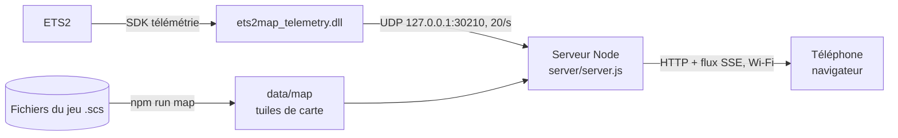

# ETS2-Map

La carte d'Euro Truck Simulator 2 en direct sur ton téléphone : position du camion, routes, échangeurs, stations, logos des entreprises, destination de la livraison, vitesse, limitation, régulateur, distance et heure d'arrivée, délai, carburant et pause.



| Partie | Dossier | Rôle |
|---|---|---|
| Plugin du jeu | `plugin/` | DLL C++ (SDK officiel SCS 1.14). Lit position, cap, vitesse, limitation, GPS, mission, carburant, heure du jeu. Envoie un petit JSON en UDP local 20 fois par seconde, 1 fois par seconde en pause. Ne bloque jamais le jeu. |
| Serveur | `server/server.js` | Reçoit l'UDP, sert l'appli et la carte, pousse la télémétrie aux téléphones (Server-Sent Events). Aucune dépendance obligatoire. |
| Appli téléphone | `web/` | Carte vectorielle dessinée en Canvas, orientée dans le sens de la marche, zoom auto selon la vitesse, gestes (glisser, pincer, double tap), thème nuit/jour, ajout à l'écran d'accueil. |
| Carte | `tools/map/` | Extrait le réseau routier de **tes** fichiers du jeu (DLC possédés seulement) et le découpe en tuiles légères (4 Mo en gzip pour toute l'Europe). |

## Utilisation

1. Double-clique **`ETS2-Map.cmd`** (ou `npm start`). La fenêtre affiche l'adresse et un QR code, par exemple `http://192.168.1.7:8080/`.
2. Sur le téléphone, connecté au même Wi-Fi, ouvre cette adresse.
   Ajoute-la à l'écran d'accueil : elle s'ouvre alors en plein écran comme une appli.
3. Lance ETS2. Au premier démarrage avec le plugin, le jeu affiche un message sur les « fonctions SDK avancées » : clique **OK**.

Boutons à droite : zoom, boussole (bascule « cap en haut » / « nord en haut »), vue d'ensemble (camion + destination), réglages.
Dès que tu déplaces la carte, le suivi s'arrête : **Recentrer** le remet.

## Installation (déjà faite sur ce PC)

```powershell
npm install               # dépendance optionnelle : QR code dans la console
npm run plugin:build      # compile la DLL (Visual Studio Build Tools 2022)
npm run plugin:test       # teste la DLL hors du jeu
npm run plugin:install    # copie la DLL dans <ETS2>\bin\win_x64\plugins\
npm run map               # extrait + découpe la carte (~2 min)
```

Le dossier du jeu est trouvé via Steam. Sinon : `--game "D:\...\Euro Truck Simulator 2"` ou la variable `ETS2_DIR`.

## Après une mise à jour du jeu

- Nouvelle version ou nouveau DLC carte : `npm run map`. Le téléphone recharge la nouvelle carte tout seul.
- Le plugin n'a pas besoin d'être recompilé (API stable du SDK).

## Tester sans lancer le jeu

```powershell
npm start            # fenêtre 1
npm run sim          # fenêtre 2 : un camion virtuel roule sur l'autoroute depuis Calais
npm run sim -- --from berlin --speed 90
```

`node server/server.js --record trajet.ndjson` enregistre une vraie session, `--replay trajet.ndjson` la rejoue.

## Options du serveur

| Option | Défaut | |
|---|---|---|
| `--port` | 8080 | port HTTP pour le téléphone |
| `--udp` | 30210 | port UDP du plugin (côté jeu : variable d'environnement `ETS2MAP_PORT`) |
| `--no-qr` | | pas de QR code |

## Hors de chez toi / écran toujours allumé

Le navigateur ne peut garder l'écran allumé de façon fiable qu'en HTTPS. L'appli tente un contournement en HTTP, sans garantie : sinon règle la mise en veille du téléphone.
Avec Tailscale (déjà installé sur ce PC) : `tailscale serve --bg 8080` donne une adresse `https://<pc>.<tailnet>.ts.net` qui marche aussi en 4G et active le maintien de l'écran.

## Désinstaller

`npm run plugin:uninstall` retire la DLL du jeu. Rien d'autre n'est modifié dans le dossier du jeu.

## Format des données

- Télémétrie (UDP puis SSE) : un objet JSON `{v:1, x, y, z, h, spd, cc, lim, nd, nt, fuel, range, gt, rest, gear, paused, truck:{…}, job:{…}|null}`. Le cap `h` vaut 0 au nord (−z) et tourne dans le sens antihoraire, sur [0, 1[. Exemple complet dans `plugin/test/harness.cpp`.
- Carte (`data/map/`) : coordonnées du jeu (mètres, x = est, y = z du jeu = sud) quantifiées au demi-mètre et codées en delta. `overview.json` pour toute l'Europe, `mid/` en tuiles de 32 km, `tiles/` en tuiles de 8 km avec zones, routes, ferries et points d'intérêt. Détails dans `tools/map/bake.ts`.

## Crédits

- Lecture des fichiers `.scs` et géométrie des routes : [TruckSim Maps](https://github.com/truckermudgeon/maps) (GPL-3.0), téléchargé dans `vendor/` et épinglé sur un commit. `tools/map/trucksim-maps.patch` y ajoute deux correctifs pour ETS2 1.61 (commentaires `/* */` dans les `.sii`, format de texture 93).
- SDK de télémétrie : SCS Software, en-têtes dans `plugin/sdk-include/`.
- Icônes des stations et logos : extraits de ta copie du jeu, jamais redistribués.
